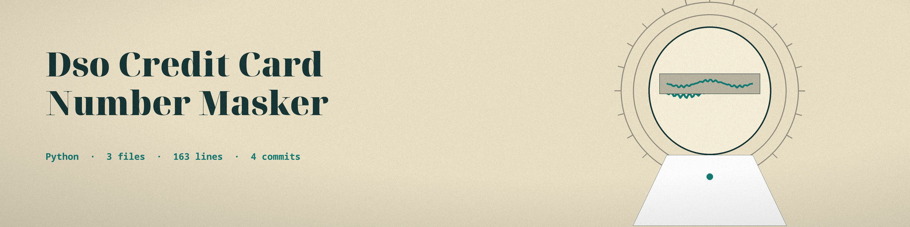

# dso-credit-card-number-masker
Masks credit card numbers within text files, replacing all but the last four digits with 'X' characters. Useful for redacting sensitive financial data from documents and logs. - Focused on Tools for sanitizing and obfuscating sensitive data within text files and structured data formats

## Install
`git clone https://github.com/ShadowGuard-AI/dso-credit-card-number-masker`

## Usage
`python3 main.py INPUT_FILE [options]`

## Parameters
- `input_file`: The input text file to process. Required.
- `-h`: Show help message and exit
- `-o`, `--output_file`: The output file to write the masked content to. If not provided, overwrites the input file.
- `-l`, `--log_file`: The log file to write logs to. If not provided, logs to console.

## License
This project is released under the license in the [LICENSE](LICENSE) file. See LICENSE for details.
